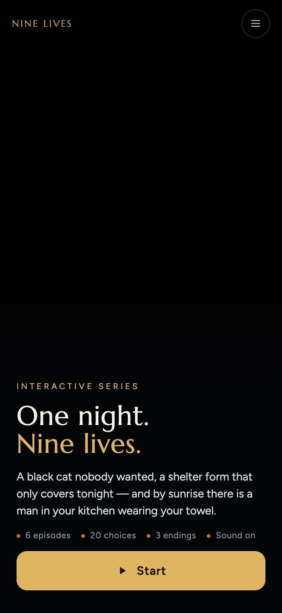
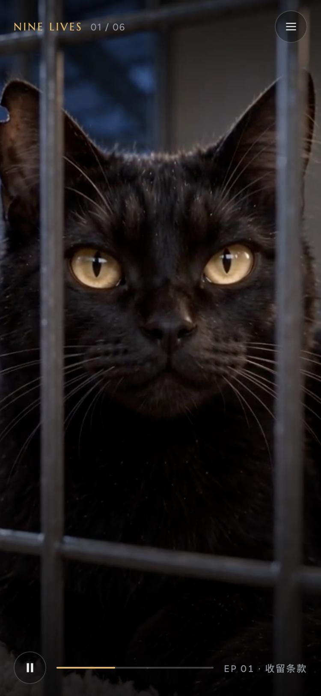
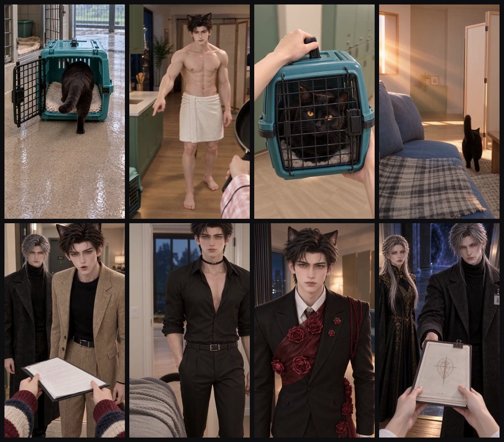

# ONE NIGHT, NINE LIVES · 捡到了黑猫大佬

竖屏互动恋爱剧集。全程女主第一人称视角，六集，二十处剧情选择，三个结局。

**在线游玩**：见仓库 About 里的 Pages 链接。手机竖屏打开体验最好。

## 预览

在线体验：https://lyx1265897416-lab.github.io/one-night-nine-lives/

| 首页 | 播放中 |
|:---:|:---:|
|  |  |

关键画面：



## 内容

| 项目 | 规格 |
|---|---|
| 集数 | 6 集，单条路线每集约 3 分半到 4 分半 |
| 剧情节点 | 176 个 |
| 互动选择 | 20 处，含 3 个结局 |
| 画幅 | 9:16 竖屏，480×852 |
| 语言 | 英语原声，中英双语字幕可切换 |
| 声音 | 视频模型直出原声，未做二次配音 |

## 玩法

- 点开始后自动连播，遇到选择会浮出选项面板。
- 选项下方有输入框，可以直接打字跟他说话；现在是本地回应，会高亮最接近的选项。
- 右上角菜单：字幕（中英 / 英文 / 关闭）、倍速、回到上一个选择、本集重来、跳集。
- 底部是播放控制与进度条，点画面可暂停。
- 章节结束有聊天式对话，第六集三条结局各有结局卡与路线回顾。

## 接入实时模型

输入框已经预留好接口。在页面里设置：

```js
window.NINE_LIVES_REALTIME = { url: "https://你的服务地址" };
```

每次提交会 POST：`{node, text, lang, memory, options}`。
服务端可以返回 `{reply:{en,zh}}` 显示一句角色回应，或再带 `target:"<镜号>"` 直接把剧情跳到那个节点。
没有配置 url 时走本地关键词回应，不会报错。

## 制作

- 画面与声音：Seedance 2.5 图生视频，原生 480p，每段带原声。
- 起始帧：GPT-Image-2 编辑生成并逐张人工复核。
- 字幕：对成片实际音轨做语音识别后与剧本逐句对齐，不按时长硬套。
- 网页版在母版基础上压制（H.264 CRF 23 / AAC 96k），画质与母版肉眼无差。

## 已知未完成项

详见仓库内 `QA.md`。本版为可完整游玩的初版，部分明显级画面问题仍在清单上。
